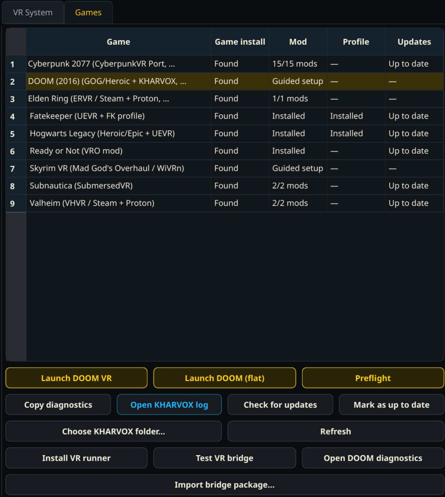
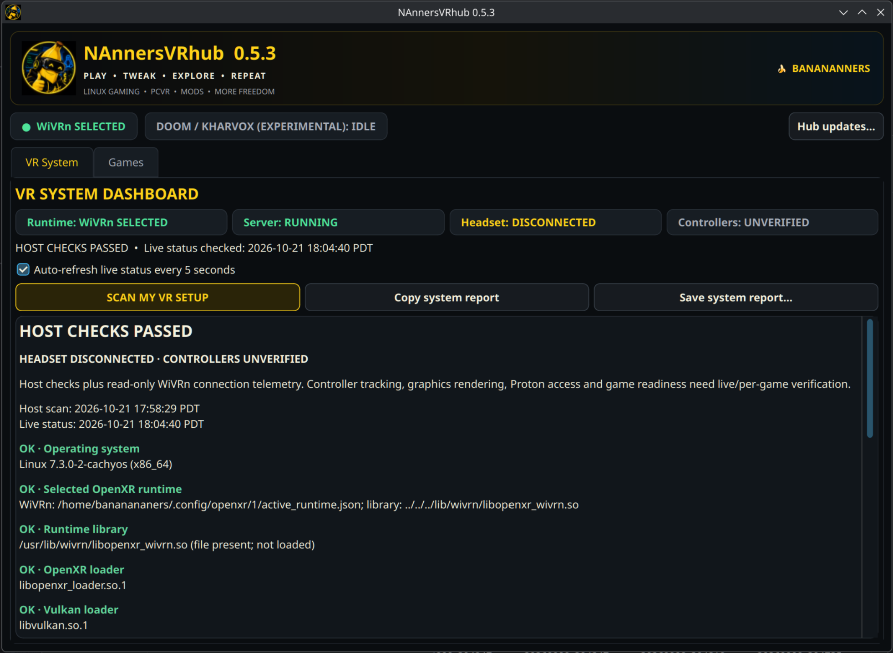
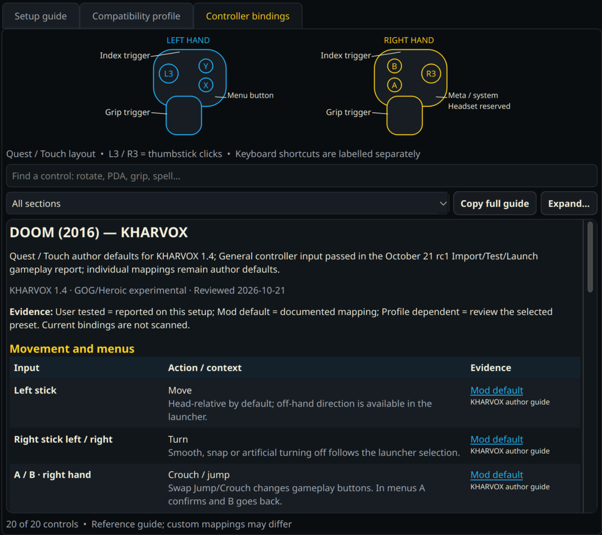

# NAnnersVRhub — VR Mod Hub for Linux

NAnnersVRhub **0.5.5** · [Release downloads](https://github.com/BananaNanners/NAnnersVRhub/releases)

A Linux VR mod hub with a player-first game library, runtime/headset diagnostics,
guided archive discovery, installation reviews, compatibility reports, controller
references and managed application updates.

See [0.5.5 release notes](RELEASE-NOTES-0.5.5.md) and the
[game capability matrix](RELEASE-SCOPE-0.5.5.md) before installing mods.
Some game workflows are review-only or external; a discovered update is not
permission to install. Current gameplay is not certified by local checks.

Final candidate validation passed 1,920 regression tests and all 17 KDE desktop acceptance checks. Evidence and limitations are recorded in
[production readiness](DEV5G-A6.6-PRODUCTION-READINESS.md).
Public update delivery is validated separately after publication.

## Screenshots







## Highlights

- Nine profiles: Skyrim VR/MGO, Fatekeeper, Ready or Not, Cyberpunk 2077,
  Heroic/Epic Hogwarts Legacy, Subnautica, Valheim, experimental Elden Ring,
  and GOG/Heroic DOOM (2016) with KHARVOX.
- Clean controller references with sourced/default/tested evidence labels.
- Subnautica and Valheim install checks and dated user gameplay evidence.
  Elden Ring remains blocked for unsupported executable versions.
- DOOM: install its isolated runner, test the bridge and launch KHARVOX/SFS.
  The standalone bridge is separately versioned and checksum-pinned.
- Thin Hub package: the full bridge source/binaries are installed only on
  explicit DOOM installation. Existing 0.5.2 updater size/resource limits
  are respected. The other profiles start without this optional component.

## Install or update

Linux, Python 3.11+ and working PySide6 are required for the Hub. Close the
old Hub, extract the verified custom source ZIP and run:

```fish
cd ~/Downloads/NAnnersVRhub-0.5.5
and python3 install.py
and ~/.local/bin/nannersvrhub
```

After publication, existing managed installations can use Hub updates → Check now → Download source ZIP → Install update → Restart Hub. Manual installation uses the custom source ZIP from the corresponding release, not GitHub’s autogenerated source archive. Close the Hub before installing manually. Game data remains separate from application files.

In Hub updates, **Roll back to [version]** verifies and switches to the retained previous application after confirmation; **Restart Hub** activates it in a new process. Only one previous app version is retained. Application rollback does not undo data changes. If that older version lacks a rollback button, the independent terminal manager remains available.

## DOOM bridge

The companion is [NAnners KHARVOX Bridge 0.2.0](https://github.com/BananaNanners/NAnners-KHARVOX-Bridge/releases/tag/v0.2.0)
(experimental). **Install VR runner** downloads and verifies its exact custom
source archive, then reuses your verified isolated runner or obtains the exact base.

For an offline alternative, download the companion archive separately and
choose **Import bridge package…** in DOOM. Select
`NAnners-KHARVOX-Bridge-0.2.0-source.tar.gz`. This verifies and installs the
component, then runs the same runner installer. Existing runner state and
matching probe results are reused; do not remove the working runner to test.

Connect WiVRn -> Test VR bridge -> Launch DOOM VR -> SFS -> campaign gameplay.
KHARVOX and the GOG game remain separate installs. Native Heroic's existing
prefix is reused. Flatpak/custom Heroic roots and Steam DOOM remain outside
the tested route. See UPDATE-TESTING-0.5.3.md for the final published-update check.

## Data and evidence

The installer deploys application files. Game installs, prefixes, saves,
mod inventories, backups and local test history remain in place. The optional
bridge cache and isolated runner are independent of Hub application rollback.
Close the Hub and run `~/.local/bin/nannersvrhub-manage rollback` to switch the
managed application version. It does not uninstall the bridge component.

The October 21 user reports cover standalone DOOM play for 40 minutes,
dev9 rendering/tracking/controller/stereo success, dev10 installation, and
rc1 Import bridge package/Test VR bridge/Launch DOOM VR success. All four
gameplay categories and the sampled local configuration passed in rc1.
Historical logs/configuration snapshots never establish
a current gameplay session. Cyberpunk's reported menu passthrough limitation
and UEVR overlay behavior remain documented in their profiles.

## AI-assisted development and user testing

NAnnersVRhub was created with AI assistance for coding, documentation and
troubleshooting, alongside hands-on user testing and automated checks. The
software may contain errors. Compatibility and gameplay reports describe
specific tested versions and setups; they do not guarantee the same result
on every system or verify a current gameplay session.

Read the [0.5.5 release notes](RELEASE-NOTES-0.5.5.md) and
[release checklist](RELEASE-CHECKLIST-0.5.5.md) for scope and acceptance. Historical 0.5.4 validation remains in [VALIDATION-0.5.4.md](VALIDATION-0.5.4.md).

## Development save recovery

Tools → Enable development tools exposes save recovery for the nine bundled profiles. Development tools start disabled each session. You can explicitly select source/target folders, back up current saves, inspect snapshot history, compare added/changed/removed files, restore a complete set, undo the last restore and remember custom paths per game. Backups are retained; saves are not merged or automatically selected by progress/date.

The development save recovery window alone offers 70%, 80%, 90% and Custom sizing (default 80% of available screen width/height). Other Hub windows have not gained these sizing controls.

## License

Original Hub code is licensed under **GNU GPL version 3 only**. See [LICENSE](LICENSE) and [NOTICE.md](NOTICE.md). The existing MIT bridge installer and separately obtained dependencies/mods retain their own terms. Licensing this Hub does not merge it into Kaon or change project ownership.
